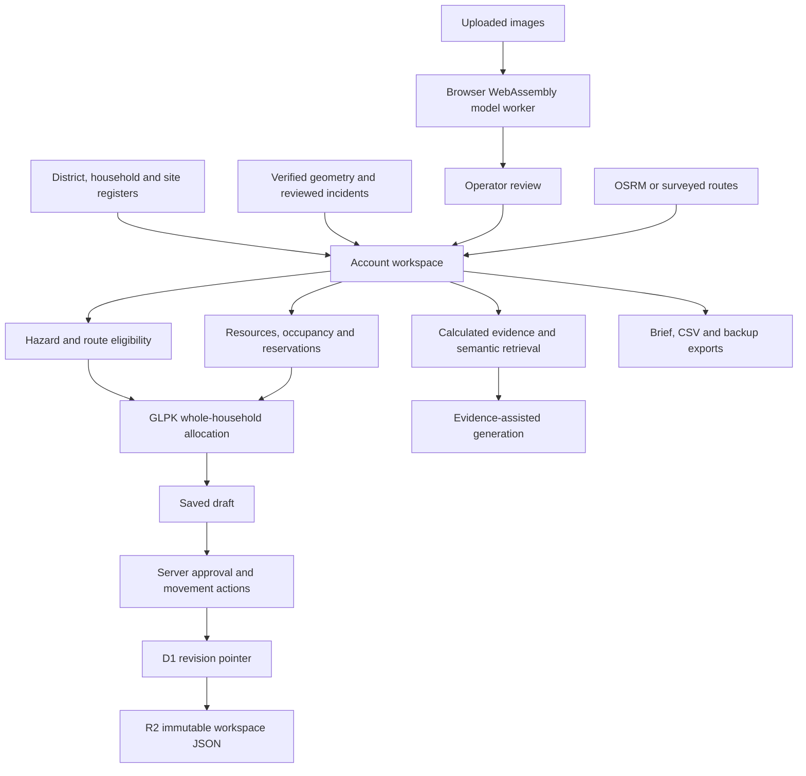

# Architecture

## Runtime and data

React/TypeScript renders the interface using Vinext. The Cloudflare Worker authenticates requests, validates bounded schemas, brokers routing, stores evidence and enforces plan actions. GLPK runs in a browser worker. Transformers.js runs pretrained ONNX models in a dedicated WebAssembly worker with packaged runtime assets and public model downloads.

The model worker serializes requests, disposes the previous task's model and caches weights. MobileBERT classifies English reports; MiniLM handles multilingual matching; SegFormer, YOLOS and CLIP analyze uploads; FLAN-T5 receives calculated evidence. General pretrained outputs require review before incident verification.

Workspace version 2 contains districts, settlements, variable-sized households, sites, hazard geometry, measured routes, reports, documents, plans, tasks and activity. An empty account is initialized with attributed district, origin, candidate-facility, document and measured-road references. No households or incidents are generated. A separate preparedness assessment register stores scenarios and results. Records have district or settlement references. Cross-district destinations require explicit opt-in.

## Tenancy and persistence

Production identity comes from the platform's trusted authenticated-user header. A client-supplied owner identifier cannot select another workspace. UUID-scoped test identities exist only on loopback in non-production development. Cross-origin mutations are rejected.

D1 workspaces hold the owner, a small R2 pointer, revision and update time. Writes upload immutable JSON, then atomically replace the pointer using the expected revision. Conflicts delete the orphan object and return HTTP 409. Current and previous object versions are retained; older previous objects are cleaned up. Version-1 data is preserved in workspace_archives before opening the empty version-2 registers.

Evidence uses a hashed owner prefix and UUID. Authenticated reads reconstruct the prefix from current identity. PNG, JPEG and WebP uploads have an 8 MB limit and non-sniffing responses. Workspace writes have a 12 MB limit with bounded record/geometry counts.

## Assessment and routing

Polygon/MultiPolygon containment supports holes. Route intersection checks line segments as well as vertices. Only verified, unexpired layers participate. Verified flood/landslide reports and covering geometry contribute declared severity; observations do not accumulate an invented probability. No covering evidence means unassessed.

OSRM supplies full GeoJSON road geometry, distance and duration. Records retain endpoints, source and timestamp. Moved endpoints, age beyond 24 hours, exclusions, linked verified closures and intersecting high-severity hazards make routes ineligible. There is no invented travel-time fallback. Provider geometry does not establish live road clearance.

## Allocation and movement

A binary household-route variable permits at most one assignment per household. Site inequalities bound the sum of sizes by resource capacity after occupancy and other approved/in-progress reservations. Filters enforce reviews, cross-district policy, assistance/medical needs, hazards and longer-term requirements.

Phase one maximizes people served. Phase two fixes achieved coverage and optimizes reviewed priority/assistance weighting with a travel-time preference. Each phase has a 15-second limit. Results are labelled optimal only when both phases establish optimality. More than 60,000 feasible combinations requires narrowing the scope.

Plans retain a SHA-256 input signature. Approval checks inputs, routes, requirements, capacity and duplicate reservations. Authoritative /api/actions operations approve, start, confirm arrivals and cancel outstanding movements using revisions. Arrival increments occupancy once; duplicate confirmation fails. Actual arrivals remain recorded when outstanding movements are cancelled.

## Recovery and grounding

An account-keyed outbox retains unsaved edits. Network failures retry; conflicts and rejected writes stop automatic overwrites and expose the draft for export. Full offline reload/maps are not provided. JSON backups include records and document text; image binaries remain in account-owned R2 storage.

Copilot shows calculated evidence alongside generated language. MiniLM retrieves source passages; FLAN-T5 receives bounded context. A numerical guard can reject new numbers but does not guarantee factuality. The assistant cannot approve plans or confirm movements. Optional Python model endpoints use server-side credentials and are independent of browser inference.

## Connected data

See [Connected data](CONNECTED_DATA.md). /api/bootstrap initializes references without overwriting an existing operating area; /api/monitor provides fifteen-minute cached Open-Meteo records. Preparedness integer-cohort allocation is separate from actual household movements. The standalone inference worker is bundled with esbuild before development/build to preserve environment detection across framework boundaries.
