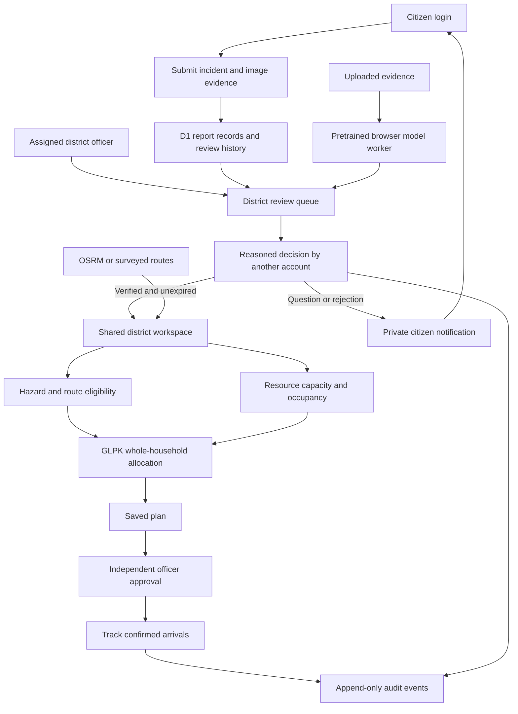

# Architecture

## Runtime and data

React and TypeScript render the interface using Vinext. The Cloudflare Worker validates account sessions, roles, assigned districts and bounded schemas; brokers routes; scopes operational data; and enforces report and plan decisions. D1 stores shared district workspace pointers, local account records, submitted incidents, immutable review history, notifications, provenance and audit events. R2 stores immutable workspace objects and private image evidence. GLPK runs in a browser worker. Transformers.js runs pretrained ONNX models in a dedicated WebAssembly worker.

One local application uses a one-time first account for the system administrator. Citizens self-register; the administrator creates officers, assigns districts, disables accounts or sets temporary passwords. Temporary-password users must change it. Passwords are salted PBKDF2-SHA-256 hashes, and session tokens are random, hashed in storage, HttpOnly, SameSite Strict and expire after twelve hours. Same-origin mutations are required. Account roles and district assignments are checked on the server for every request.

Citizens can read only their own incident records and evidence. Officers can read reports for assigned districts and edit those districts' registers. Administrators can manage accounts and district operations. Account profile and district-scoped scenario preferences remain per account; operating records are shared within the organization.

## Incident review

A submitted incident is stored separately from the operational workspace and enters a district queue. The application records the submitter identity, district, source, observation time, attached evidence, status, revision and an append-only event history. A citizen may add evidence only to their own report when information was requested. A reviewer must be a different account and an enabled administrator or officer assigned to the report's district.

The permitted status flow is Submitted / Pending → Under review → Verified, Rejected or Needs information → Resolved. Citizens can reply to requests; an officer reopens a closed record for new independent review. Every decision requires an explanatory note and records the acting identity and timestamp. Revision checks prevent conflicting reviews; D1 batch writes group the report update, event, audit entry and submitter notification. A reported category or model suggestion is not proof. Verification records the reviewed category, severity, location, linked route and an expiry within seven days. Expired reports stop affecting risk and route eligibility. Audit entries have no application update/delete API.

## Operational records and persistence

The shared workspace contains districts, settlements, variable-sized households, sites, hazard geometry, measured routes, documents, saved plans, tasks and preparedness assessments. Public reference districts connect once with attributed geography and candidate facilities. No residents, incidents or official hazard polygons are fabricated. Before first initialization, an existing local workspace is copied into shared storage; its reports enter review as legacy-pending records, and the old workspace archive is retained.

D1 stores a shared workspace owner, R2 object pointer, revision and update time. Writes upload immutable JSON then atomically change the pointer using the expected revision. Conflicts delete the unreferenced object and return HTTP 409. Current and previous object versions are retained. Changes to an officer's districts do not reveal other district records; server-side merging preserves records outside their access scope. Image uploads are owner-private and also readable to assigned district staff. Content-type signatures, size limits and no-sniffing responses are enforced.

## Assessment and routing

Polygon/MultiPolygon containment supports holes. Route intersection checks lines as well as vertices. Only verified, unexpired layers participate. Verified flood/landslide reports and covering geometry contribute their declared severity; observations do not accumulate an invented probability. Locations without covering evidence remain unassessed.

OSRM supplies GeoJSON road geometry, distance and duration. Records retain endpoints, source and timestamp. Moved endpoints, records older than 24 hours, exclusions, linked verified closures and intersecting high-severity hazards make routes ineligible. Provider geometry does not establish live road clearance.

## Allocation and movement

A binary household-route variable permits at most one assignment per household. Site limits bound the sum of household sizes by resource capacity after occupancy and outstanding reservations. Filters enforce site review, district access, cross-district policy, medical or accessibility needs, hazards and longer-term requirements.

Phase one maximizes people served. Phase two holds achieved coverage fixed, then optimizes reviewed priority and assistance weighting with a travel-time preference. Time-limited solutions are labelled feasible. Plans include the actor and input district scope. A different authorized officer must approve a draft. Approval rechecks the input signature, site capacity and route requirements. Authoritative actions start movements, confirm arrivals and cancel outstanding movements. Arrival increments occupancy once; direct register edits cannot reduce occupancy below confirmed arrivals.

## Recovery and grounding

An account-keyed client outbox retains unsaved staff edits. Network failures preserve a draft; conflicts stop automatic overwrites and require explicit reload or draft export. Full offline reload and maps are not provided. JSON backups include shared registers and document text; image binaries remain in account-scoped object storage.

Copilot answers supported workspace questions with deterministic calculations and retrieves bounded, source-labelled passages with MiniLM. General questions and short follow-ups use the quantized Qwen2.5 0.5B Instruct model in chat format; FLAN-T5 Small remains for short evidence-assisted generation. Generated answers are unverified and have no live web access. Generated language cannot verify a report, approve a plan or confirm an arrival. Models are assistance, not guarantees of factual accuracy.

## Connected data

See [Connected data](CONNECTED_DATA.md). Weather fetches use Open-Meteo; maps attribute OpenStreetMap and satellite providers. Preparedness integer-cohort allocation is separate from actual registered household movements. The standalone inference worker is bundled before development and production builds.
