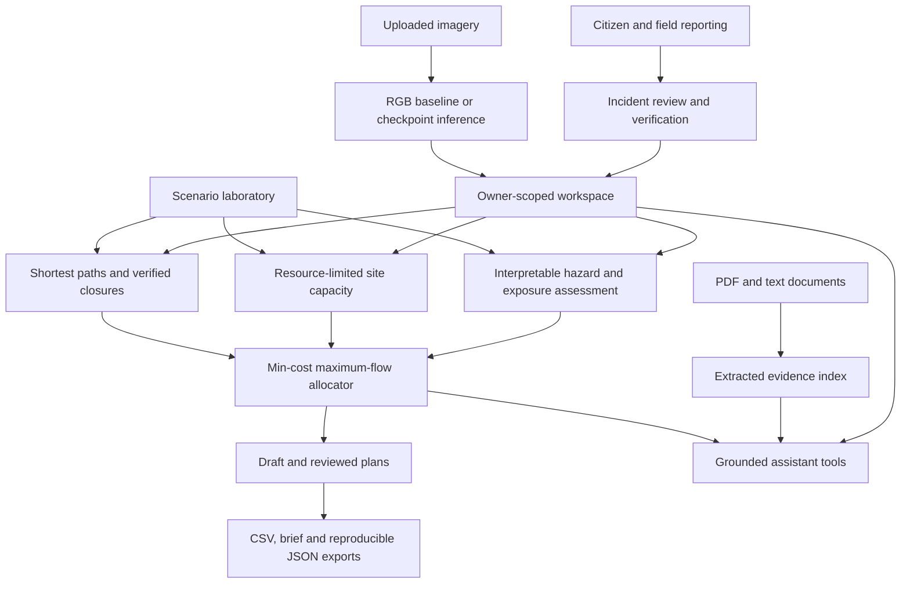

# Architecture

## Runtime boundaries

The React client renders views and computes transparent planning proposals. The Worker validates persisted data, scopes D1 and R2 records to the authenticated owner, and brokers model-service requests without revealing service credentials. The Python service loads locally trained checkpoints. The inference service is a separate deployment; it is not silently assumed to run inside Cloudflare Workers.

The initial hazard indicators and road network are exercise inputs. A verified incident adds an explicit severity contribution (maximum five points) to the associated settlement score; duplicate reports do not accumulate this contribution. Flood masks are image evidence, not automatically future-hazard forecasts. A site being outside a simulated footprint does not certify its safety. Actual hazard identification requires regionally valid data and independent validation.

## Persistence

`workspaces` stores an owner identifier, JSON payload, revision and update timestamp. Writes validate a bounded schema and compare the expected revision atomically. A stale client receives HTTP 409. The client stops overwriting and retains an offline outbox. No user-provided identifier can select another owner's workspace.

Images are stored under `SHA256(owner)/UUID` in R2 and served only after resolving the current authenticated owner. Only PNG, JPEG and WebP uploads are accepted, with size limits and `nosniff` responses.

## Allocator

Each settlement is split into assisted and general four-person household cohorts. Source edges represent demand; cohort-to-site edges represent feasible routes and eligibility; site-to-sink edges represent available household slots. Successive shortest augmenting paths using Bellman-Ford solve integer min-cost maximum flow, including residual reassignment.

Maximum flow determines feasible coverage. Edge cost is `(100 − risk) × 8 + assisted penalty + exposure-weighted distance × 10`. General cohorts receive a 120-unit penalty. These coefficients are declared design assumptions requiring sensitivity analysis, not learned policy preferences. The nearest-eligible-site baseline uses the same constraints and a fixed cohort order.

Resource capacity is the minimum of space, water and sanitation limits less occupancy. Fractions of households are never allocated. Distances use the illustrative graph, not a public routing API or live traffic.

## Assistant and model grounding

Local responses are calculated or retrieved. Document retrieval currently ranks passages using keyword matches. Connected T5 summarization receives already-calculated context. A numerical consistency guard rejects newly invented numbers but does not guarantee full factual consistency. No assistant response sends alerts, approves a plan or dispatches vehicles automatically.

## Evaluation boundaries

The TypeScript test suite verifies constraint satisfaction and behavior changes. It does not establish operational safety. Deep-learning performance requires real checkpoints and event/geography-disjoint datasets. Training pipelines enforce event-disjoint manifests, select on validation data and export test results. No model accuracy, response-time benchmark or real-world reduction in disaster losses is claimed without measurement.
