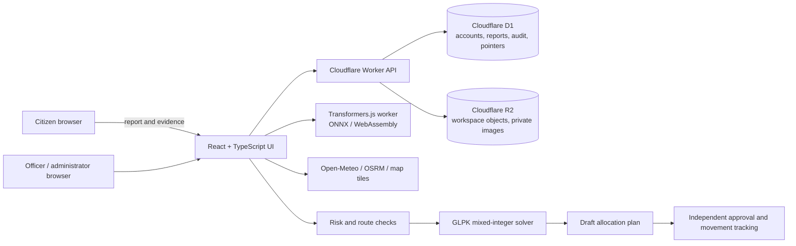

# SurakshaSetu Viva Questions and Answers

This guide reflects the current project source and documentation. Learn the short answers in your own words and be ready to show the matching screen in the app. Do not describe an assumption, model score, forecast, or old reference map as a verified emergency fact.

## 60-second project introduction

> SurakshaSetu is a multi-district disaster information and relocation-planning web application. Citizens can submit incident reports with evidence. An assigned district officer reviews each report independently, and verified, unexpired reports can inform the operational map. Staff can register households, review candidate sites and their water, space, and sanitation capacity, check measured road routes, and calculate a plan that keeps each household together. The application uses pretrained AI models to assist with report and image interpretation, but the models do not issue official warnings or verify incidents. The frontend is built with React and TypeScript, the backend runs in a Cloudflare Workers environment, D1 stores relational records, R2 stores larger objects and private evidence, and GLPK solves the allocation problem.

## Architecture in one picture

The main code references are [Architecture](ARCHITECTURE.md), [Connected data](CONNECTED_DATA.md), [Operations](OPERATIONS.md), and [Validation](VALIDATION.md).

## A. Project purpose and workflows

### 1. What problem does SurakshaSetu address?

It brings together incident reporting, geographic evidence, resource capacity, route checks, and household relocation planning. The goal is to help staff organize evidence and compare plans before field action.

### 2. Who uses the application?

There are three roles: citizens submit and follow up on their own reports; district officers manage records and review reports within assigned districts; administrators manage accounts and have organization-wide access.

### 3. Why are there separate citizen and officer accounts?

The person reporting an incident should not be the only person who verifies it. Separate roles create a review trail and prevent a submitter from verifying their own report.

### 4. Does AI automatically approve incident reports?

No. AI can suggest categories, find possible duplicate reports, or describe an image. It cannot verify the location, time, source, or truth of a report. An authorized, different account makes and records the review decision.

### 5. What happens from incident submission to use on the map?

A citizen submits a report and optional image. It enters a district review queue. An assigned officer can request more information, reject it, verify it with a reason, or resolve it later. Only a verified, unexpired report contributes to operational assessments.

### 6. What is the relocation-planning workflow?

Staff register households and candidate receiving sites, review the sites’ capacity and services, obtain measured routes, and calculate a draft. A separate authorized officer reviews and approves it. Staff then record movement progress and confirm arrivals.

### 7. Why is approval still required if the plan is calculated automatically?

The solver checks constraints in recorded data; it cannot confirm that a building is open, a road is passable now, or a household is actually ready to move. Approval is a human operational check. A different officer must approve a draft plan.

### 8. Is this an official emergency response system?

No. It is a classroom decision-support model. It is not connected to emergency dispatch and it does not replace district authorities, field verification, or official warnings.

### 9. What does “multi-district” mean here?

One organization workspace can hold several districts. Administrators can see the organization scope; officers are restricted to districts assigned to their accounts; citizens see their own incident reports.

### 10. What is the main output of the system?

Evidence-backed operational records and a draft household allocation showing who could be assigned to which eligible site, with unallocated people, capacity limits, route information, and solver status visible.

### 11. What does the project do that a spreadsheet alone does not?

It connects role-scoped reports, map geometry, expiring evidence, site eligibility and capacity, route restrictions, whole-household allocation, approvals, arrival tracking, and audit history in one workflow.

### 12. What is a limitation you should state clearly?

It is only as reliable as the data entered and the external sources available. Map data and forecast feeds can be stale or incomplete, AI can be wrong, and no screen result certifies that a place is safe.

## B. Frontend and technology stack

### 13. What is the frontend built with?

React 19 and TypeScript. The project uses Vinext with Vite tooling and the Cloudflare Vite plugin to build and run the application for the Workers environment.

### 14. Why use TypeScript?

TypeScript adds static types to JavaScript. It helps catch mismatched records and invalid values while developing features such as households, sites, reports, and plans.

### 15. What is React responsible for?

React renders the screens from reusable components and updates the interface when the user changes districts, filters, forms, map layers, or records.

### 16. How does the application navigate between pages?

The main app uses hash-based page navigation. For example, a URL ending in `#incidents` opens incident reports. This lets the client switch between the main workspace sections.

### 17. What is Vinext in this project?

Vinext is the framework layer used with Vite to run a Next-compatible React application. The project is bundled for the Cloudflare Workers runtime rather than using a traditional standalone Express server.

### 18. What libraries support the interface?

Tailwind CSS and project CSS provide styling; Lucide React supplies icons; Recharts supplies charts; React Hook Form and Zod help handle and validate forms; PDF.js is used to read PDFs.

### 19. Is the map built with Leaflet or MapLibre?

No. The project has a custom map component. It projects coordinates with Web Mercator, displays raster map or satellite tiles, and draws vector overlays such as polygons, points, and routes in SVG.

### 20. How does the map let users inspect several kinds of information?

Map layers can show settlement evidence, district rainfall screening, verified hazard geometry, sites, road routes, and an optional historical Wayanad susceptibility case study. The legend and layer labels distinguish these types of information.

### 21. What is the purpose of the responsive interface?

It lets the same core workflow adapt to different screen sizes. Some operational tasks, especially dense maps and register editing, are easier to demonstrate on a laptop.

### 22. How are forms validated?

The interface uses form libraries and Zod schemas, and the server validates important request data again. Client validation improves usability; server validation is required for trust and security.

### 23. What is the difference between a chart and a map in the system?

A chart summarizes numerical comparisons, while the map shows where records and geographic layers are located. Neither view changes the quality of the underlying evidence.

## C. Backend, storage, and account security

### 24. What is the backend runtime?

The API runs as a Cloudflare Worker. In local development Wrangler provides the Worker runtime and local persistent storage.

### 25. What does the backend do?

It authenticates requests, checks roles and district access, validates and saves records, stores report and audit events, brokers selected server-side operations, and enforces report and plan state transitions.

### 26. Which databases or storage services are used?

Cloudflare D1 is the SQLite-compatible relational store for accounts, sessions, incident records, review events, notifications, audit entries, and workspace pointers. R2 stores larger immutable workspace JSON objects and private image evidence.

### 27. Why use both D1 and R2?

D1 is suitable for indexed records and transactions. R2 is suitable for larger objects such as workspace snapshots and image files. D1 stores the current workspace object pointer and revision.

### 28. What is Drizzle ORM used for?

Drizzle defines typed SQLite table schemas for the D1 data. Some runtime queries use prepared statements through the D1 API directly.

### 29. How does the application avoid overwriting a newer workspace change?

Workspace writes include an expected revision. The backend only advances the pointer if the revision still matches; otherwise it rejects the stale write with a conflict response so a newer update is not silently lost.

### 30. What does immutable workspace storage mean?

Each saved workspace snapshot is stored as an object, and D1 points to the current object. Updating the pointer preserves previous objects and avoids editing a large JSON object in place.

### 31. How are passwords stored?

The application stores salted PBKDF2-SHA-256 password hashes, not plaintext passwords. The implementation uses 100,000 iterations and a per-password random salt.

### 32. What is stored in a browser session cookie?

The browser receives a random session token in an HttpOnly, SameSite Strict cookie. The database stores a hash of the token, and the session expires after 12 hours. HttpOnly prevents ordinary page JavaScript from reading the cookie.

### 33. How does role-based access control work?

The backend checks the signed-in account’s role and assigned district IDs for protected actions. The interface may hide unavailable controls, but the server is the authority for permission checks.

### 34. What is district scoping?

An officer’s requests are limited on the server to the districts assigned to that officer. This is important because hiding another district in the UI alone would not protect its records.

### 35. How is evidence kept private?

Evidence file metadata is stored with its owner and district, and uploaded image objects are access-scoped so the submitter and appropriate assigned district staff can access them.

### 36. What is an audit event?

It is a timestamped record of an important action, actor, target, and detail. Report decisions, account actions, and operational changes can be reviewed later for accountability.

### 37. What does “append-only” review history mean?

The application adds a new event for each review action instead of erasing the earlier decision trail. This makes it possible to see who changed a report and why.

### 38. How does the system prevent self-verification?

The server checks that the reviewer’s account differs from the report submitter and that the reviewer is authorized for the report’s district.

### 39. What happens if the connection drops while editing?

The client can retain unsaved staff edits in an account-keyed outbox. If the server reports a revision conflict, it stops automatic overwriting and asks the user to reconcile the draft.

### 40. Is the application fully offline?

No. Some AI weights can be cached and unsaved edits may be retained, but the application is not a fully offline map package and relies on network services for some data and operations.

## D. Data sources, datasets, and map interpretation

### 41. What is the difference between the application’s datasets and the models’ training datasets?

Application datasets are operational or geographic inputs such as district boundaries, roads, facility references, forecasts, and reports. Model training data belongs to the pretrained model publishers. This project does not train the models on its operational data.

### 42. Which districts are connected in the reference setup?

Wayanad, Idukki, and Kozhikode. The connected reference pack includes boundaries, named planning origins, public school records, and measured road connections.

### 43. Are the connected schools automatically treated as shelters?

No. They are candidate facilities from public records, not designated or approved shelters. Staff must review site safety, current availability, water, sanitation, space, and other requirements before the site is eligible.

### 44. Where does district population data come from?

The reference pack uses district population values from Census 2011 as historical context. They are not current population counts, household registrations, or evacuation totals.

### 45. Where do school capacity inputs come from?

School and facility facts link to individual Kerala KITE Sametham records. Classroom and toilet counts are source facts; usable emergency capacity still depends on explicit assumptions and field review.

### 46. What is OpenStreetMap used for?

OpenStreetMap is used for geographic boundaries, map information, and road-network data through routing services. The map includes attribution to OpenStreetMap contributors.

### 47. What does OSRM provide?

OSRM provides a road route geometry, distance, and estimated duration between recorded endpoints based on available road-network data. It does not confirm that a road is currently open or safe.

### 48. What does Open-Meteo provide?

Open-Meteo provides current weather model conditions and daily forecasts. The interface records an observation time and can cache forecasts; the feed may be unavailable or stale.

### 49. How is the rainfall screen categorized?

It uses the maximum daily rainfall value across the next three forecast days: under 15 mm is routine, 15 to under 35 mm is watch, 35 to under 65 mm is elevated, and 65 mm or more is high. These are project screening bands, not official alert thresholds.

### 50. Is a rainfall probability the probability of a flood or landslide?

No. A precipitation probability or rainfall screening band describes forecast rainfall. It is not a calibrated probability that a flood, landslide, or other disaster will occur.

### 51. What is the Wayanad susceptibility overlay?

It is a separate case-study layer converted from a KSDMA-distributed NCESS 2010 landslide-susceptibility KML file. It has 269 polygons labelled High, Medium, or Low. It is historical baseline susceptibility information and does not become a current verified incident layer.

### 52. What do the map colors mean?

The meaning depends on the active layer. Red/orange/amber/green can represent an evidence severity label, a rainfall screening band, or a baseline susceptibility class. Green means only the layer’s stated low/routine category; it does not certify a place as safe. Grey or neutral may mean unassessed or unavailable.

### 53. What is the difference between “unassessed” and “low risk”?

Unassessed means the workspace has no qualifying evidence for that location. Low means a particular layer or reviewed record has a low category. Missing information must not be interpreted as proof of safety.

### 54. What is the difference between hazard, exposure, vulnerability, and capacity?

Hazard is a potentially damaging event or condition. Exposure is people or assets located where it may affect them. Vulnerability describes how susceptible they may be to harm. Capacity is the resources available to support them. The project records or screens parts of these concepts; it does not calculate a complete scientific risk model.

### 55. How does operational risk scoring work?

The map considers active verified hazard geometry and verified, unexpired flood or landslide reports. It uses the declared severity, and the highest applicable score labels the settlement. It is an evidence-severity indicator, not a forecast probability.

### 56. What is GeoJSON?

GeoJSON is a JSON format for geographic features. The project uses Polygon or MultiPolygon features for areas and coordinate arrays for points and route lines. Coordinates are stored in longitude, latitude order.

### 57. How are hazards and routes checked spatially?

The engine checks whether settlement or site points fall inside hazard polygons and whether a route line intersects a hazard polygon. Expired or unverified hazard layers do not count as active verified hazards.

### 58. What happens when a route is old or its endpoints changed?

Routes older than 24 hours or whose saved endpoints no longer match the current settlement and site are excluded from eligibility. Verified closures and intersecting high-severity hazards can also exclude a route.

### 59. Are the sample image and reference locations live incident reports?

No. The Wayanad image in the image-analysis page is an attributed historical photograph for demonstrating the models. It is not evidence of a current emergency.

### 60. Does the application invent households or incident reports?

No. Actual household and report records must be entered or submitted by users. Preparedness assessments can use explicitly labelled assumptions, but those modeled figures are not actual residents or verified incident counts.

## E. Machine learning and AI models

### 61. Did the project train custom machine-learning models?

No. It uses pretrained public model weights and inference pipelines. The project integrates the models; it does not train or fine-tune them on local disaster data.

### 62. Where does AI inference run?

The browser loads Transformers.js in a dedicated WebAssembly worker and runs quantized ONNX weights on the user’s device. Model weights are downloaded on first use and may be reused from browser cache. There is no inference API key or cloud AI inference server in the normal model workflow.

### 63. Why use a Web Worker?

Image and language inference can be computationally heavy. A worker keeps this processing off the main UI thread so the interface is less likely to freeze while a model runs or loads.

### 64. What does quantized `q8` mean in this project?

The model pipeline requests 8-bit quantized weights. Quantization reduces model storage and memory needs and can make local inference more practical, while it may trade some numerical precision for efficiency.

### 65. Which model suggests incident categories from English text?

`Xenova/mobilebert-uncased-mnli` is used with a zero-shot text-classification pipeline. It compares a report with candidate labels such as flood, landslide, infrastructure damage, or a request for assistance. Its output is a suggestion for review.

### 66. How does zero-shot text classification work here?

The application supplies category labels at inference time. The model ranks how well the report text matches those labels using its natural-language-inference capability; the project does not train a new classifier for those labels.

### 67. Which model supports multilingual semantic search and matching?

`Xenova/paraphrase-multilingual-MiniLM-L12-v2`. It converts text to vector embeddings. The application compares normalized vectors using cosine similarity to find semantically similar text or document passages, including Hindi matching.

### 68. What does cosine similarity mean?

It measures how close two embedding vectors point in the same direction. A higher similarity indicates more semantic resemblance for the specific comparison; it is not a probability that a report is true or that an event will happen.

### 69. Which model produces the plain-language image caption?

`Xenova/vit-gpt2-image-captioning`. It is an image-to-text model that uses a Vision Transformer (ViT) image encoder and a GPT-2 text decoder to generate a short caption.

### 70. Which model compares an image with disaster descriptions?

`Xenova/clip-vit-base-patch32`. CLIP embeds an image and candidate text descriptions in a shared representation and ranks their relative matches. The project includes disaster categories and ordinary-scene alternatives.

### 71. Does the CLIP score show the probability of a disaster?

No. It is a relative ranking among the candidate descriptions supplied for that image. It is not calibrated as an event probability, and it cannot establish whether the image depicts a current local event.

### 72. Why combine CLIP with an image captioner?

CLIP offers a category comparison, while the captioner provides a human-readable description. Together they give an operator two kinds of visual clues, but they can still be wrong and do not replace verification.

### 73. Which model performs scene segmentation?

`Xenova/segformer-b0-finetuned-ade-512-512`, a SegFormer B0 model fine-tuned for ADE20K scene labels. It identifies general scene regions/classes; its masks do not estimate water depth, structural damage, or safety.

### 74. Which model performs object detection?

`Xenova/yolos-tiny`, a small YOLOS transformer-based object detector. It can draw boxes around general objects from its supported label set; it is not a specialized disaster-damage detector.

### 75. Which model supports generated assistant responses?

`onnx-community/Qwen2.5-0.5B-Instruct` supports general Copilot chat using a chat template and quantized text-generation pipeline. `Xenova/flan-t5-small` remains for short evidence-assisted generation. Deterministic code answers supported workspace questions, retrieves records, and handles a curated set of disaster explanations and precautions with official source links. It refuses to infer whether a hazard is occurring right now.

### 76. Is every Copilot answer generated by an LLM?

No. Many workspace questions are answered by ordinary application logic using registered data, and semantic retrieval can find source passages. Curated safety answers use deterministic text and official links. Qwen is used for general chat and FLAN-T5 for selected evidence-assisted language-generation tasks. The small general model can make factual mistakes, so its answers are marked unverified.

### 77. What data is passed to the evidence-assisted language model?

The application builds a bounded prompt from the user’s question and relevant local evidence available to that account. The prompt instructs the model not to add unsupported facts. Prompting reduces unsupported claims but cannot guarantee correctness.

### 78. Does the chatbot have live internet or official alert access?

No. The local Qwen and FLAN-T5 models have no general live web connection. Qwen can use workspace context supplied by the application, but it cannot confirm live incidents or official warnings unless current verified evidence is explicitly present in the workspace.

### 79. Why are the models described as advisory?

They were not validated as operational disaster-warning or emergency-response models for these districts. Their output may be affected by image quality, language, domain mismatch, model bias, and uncertainty.

### 80. How do you know the model is accurate?

We measured small diagnostic evaluations with the application's quantized models and candidate labels. MobileBERT top-1 accuracy was 50% on 60 authored English reports and 16.67% on 12 Hindi reports. CLIP accuracy was 68.33% on 60 deterministically selected DisasterVQA images across five disaster classes. Document retrieval achieved Recall@3 of 95.83% on 24 authored English/Hindi questions. Per-class precision, recall, F1, confusion matrices and provenance are in [Model evaluation](MODEL_EVALUATION.md). These are limited sample results, not validated operational accuracy. A representative, independently labelled local held-out dataset is still needed for a field-performance claim. Detection, segmentation and generated-answer accuracy require their own annotations and metrics.

### 81. What is a model’s training dataset in this project?

There is no project-specific training dataset because no model was trained here. The model publishers provide pretrained weights and model cards. For example, the SegFormer variant is identified as fine-tuned on ADE20K; the other upstream model cards describe their own provenance. The application’s GIS and weather data are separate from those training corpora.

### 82. What happens if the model weights fail to load?

That model task cannot produce a result until the weights load. The UI should report that state; the rest of the application’s non-AI records and calculations remain separate. First use also needs network access to download model weights unless they are already cached.

### 83. Does image analysis estimate what disaster might happen next?

No. A still image can provide visual clues about what appears in that image, not a calibrated forecast of future hazards. If a district is selected, the screen may add rainfall forecast context and active verified workspace evidence, clearly labelled as separate signals.

### 84. What precautions can image analysis provide?

It can display general precaution guidance based on the apparent scene category and direct users to official sources. It cannot tailor a safe evacuation route or replace instructions from local authorities.

## F. Risk, capacity, routing, and optimization

### 85. What is a mixed-integer linear program (MILP)?

It is an optimization model with a linear objective and constraints, where some decision variables must be integers or binary. Here, binary variables represent whether a whole household uses a particular route to a particular site.

### 86. Why use a MILP for relocation planning?

The problem has discrete choices and interacting limits: keep households together, do not exceed site capacity, respect route and site eligibility, and choose among possible destinations. A MILP solver can search for a feasible high-coverage allocation under these constraints.

### 87. What is the main decision variable?

For each feasible household-route pair, a binary variable is 1 if that household is assigned through that route and 0 otherwise.

### 88. How does the system keep each household intact?

Each household has a constraint that allows at most one selected route assignment. This prevents the solver from splitting one household across multiple sites.

### 89. How is capacity calculated?

For each site, the applicable capacity is bounded by its space, water, sanitation, and—when planning long-term—sustainable-capacity limits. Existing occupancy and reservations reduce places available for a new plan.

### 90. What is the bottleneck resource?

It is the smallest applicable resource limit at a site, such as space, water, sanitation, or sustainable capacity. That smallest limit determines the site’s effective maximum capacity.

### 91. How are special needs handled?

Households requiring assistance or medical support can only be assigned to sites meeting the relevant accessibility or medical requirements. Longer-term plans have additional site-review requirements.

### 92. How are the optimization objectives ordered?

First the solver maximizes the number of people assigned. A second solve fixes that coverage level, then considers declared household priority and assistance needs while preferring shorter travel. This stops the second-stage ranking from reducing achieved coverage.

### 93. What does “Optimal” versus “Feasible” mean on a plan?

Optimal means the solver reported an optimal solution for the relevant stages. Feasible means it found a valid allocation but did not establish optimality within the time or solver limits. Both should be interpreted with the input data and constraints.

### 94. What happens to people the solver cannot place?

They are shown as unallocated. The system should not hide this gap; staff can review assumptions, increase verified capacity, adjust allowed routes or districts, or arrange other resources.

### 95. How do prepared assessments differ from actual household plans?

Prepared assessments use explicit scenario assumptions and integer cohorts at origins, such as a configured exposure fraction and assumed household size. Actual household movement planning uses individually registered households with their real recorded sizes and needs. A preparedness estimate is not a resident register.

### 96. What are the default preparedness assumptions?

The defaults include a 0.05% exposure fraction, assumed household size of four, 45 m² room area, 60% usable fraction, 3.5 m² per person, assumed daily water budget and 20 litres per person per day, 20 people per toilet, 40 vehicle seats, a maximum travel time, and district-crossing settings. These are scenario inputs, not surveyed facts about a specific building or household.

### 97. Does a route’s estimated travel time mean the route is safe now?

No. It is a routing estimate based on road-network data. The route can become ineligible due to age, endpoint changes, a recorded closure, or intersecting verified hazard evidence, but field confirmation is still needed.

### 98. When does a calculated draft become an operational movement?

After an authorized different officer reviews and approves it. The application then tracks movement states, and confirmed arrival updates site occupancy. Approval or calculation alone does not mean people have moved.

## G. Testing, demonstration, and likely examiner follow-ups

### 99. How would you demonstrate the full workflow?

Show the map and explain its layers; sign in as a citizen and submit a report; sign in as an assigned officer and review it; register a household and inspect candidate site reviews; calculate a draft; approve it with a different authorized account; then record movement and arrival. Finally, show the audit/review history and the image-analysis screen with its limitations.

### 100. What should you show to demonstrate role security?

Use accounts with different roles and assigned districts. Show that a citizen sees their own reports, an officer sees the assigned district queue, and an administrator can manage accounts. Explain that these are enforced by the backend, not just hidden buttons.

### 101. How would you test a report workflow?

Check that a citizen can submit and follow up; an authorized officer can request details or make a reasoned decision; the submitter cannot verify their own report; the report status and event history update; and only an active verified report informs relevant operational calculations.

### 102. How would you test allocation correctness?

Check that no household is split, site capacities are not exceeded, ineligible routes/sites are excluded, assisted or medical requirements are respected, occupied/reserved places are subtracted, and served plus unallocated people equals demand.

### 103. Which tests exist in the repository?

The project includes type checking, automated tests, API integration tests, and model smoke tests. Model smoke tests can download weights; the repository’s validation document describes test scope. Do not claim tests passed in a particular run unless you actually ran and recorded them.

### 104. What is one strong future improvement?

Create a carefully consented, locally representative and independently labelled dataset of hazard images and reports, then evaluate models on held-out districts and conditions. Add calibrated uncertainty and bias analysis before considering operational claims.

### 105. What other future improvements are appropriate?

Add more authoritative and routinely updated source feeds, field-validation workflows, more route providers, disaster-specific model evaluation, accessible multilingual interfaces, load/security reviews, and documented operational procedures with relevant authorities.

### 106. What is the difference between verification and prediction?

Verification is a review decision about a particular submitted observation using its evidence and provenance. Prediction estimates a future event from a validated forecasting model. This project has evidence screening and forecast context, but it does not provide a validated disaster-occurrence prediction.

### 107. If asked whether this project can guarantee a safe shelter, what do you say?

No. It can show recorded resource limits and review status. Only current, competent field assessment and official decisions can determine suitability and safety.

### 108. If a teacher says the system still has manual work, how do you answer?

The application automates record organization, eligibility checks, capacity arithmetic, route screening, and constrained allocation. People still verify evidence, review site conditions, approve plans, and confirm arrivals because those facts require accountable field judgment.

## Model catalogue and source links

| Model ID | Project task | Plain-language interpretation |
| --- | --- | --- |
| [`Xenova/mobilebert-uncased-mnli`](https://huggingface.co/Xenova/mobilebert-uncased-mnli) | Zero-shot English incident text classification | Ranks supplied report categories for a human reviewer. |
| [`Xenova/paraphrase-multilingual-MiniLM-L12-v2`](https://huggingface.co/Xenova/paraphrase-multilingual-MiniLM-L12-v2) | Embeddings for semantic retrieval and multilingual matching | Finds similar text; cosine similarity is not truth probability. |
| [`Xenova/segformer-b0-finetuned-ade-512-512`](https://huggingface.co/Xenova/segformer-b0-finetuned-ade-512-512) | General scene segmentation | Colours regions by general visual class; not damage or safety analysis. |
| [`Xenova/yolos-tiny`](https://huggingface.co/Xenova/yolos-tiny) | Generic object detection | Detects supported general object classes with boxes. |
| [`Xenova/clip-vit-base-patch32`](https://huggingface.co/Xenova/clip-vit-base-patch32) | Image-to-text candidate matching | Relative ranking of candidate descriptions; not calibrated probability. |
| [`Xenova/vit-gpt2-image-captioning`](https://huggingface.co/Xenova/vit-gpt2-image-captioning) | Image caption generation | Produces a short general description from an image. |
| [`onnx-community/Qwen2.5-0.5B-Instruct`](https://huggingface.co/onnx-community/Qwen2.5-0.5B-Instruct) | Local Copilot chat | Quantized instruction-following model; about 480 MB on first use; still can be wrong. |
| [`Xenova/flan-t5-small`](https://huggingface.co/Xenova/flan-t5-small) | Short evidence-assisted text generation | Generates concise text; can be wrong and must be checked. |

## Quick revision sheet

- **Frontend:** React + TypeScript; Vinext/Vite; custom SVG map; Recharts/PDF.js and supporting interface libraries.
- **Backend:** Cloudflare Worker API; local development via Wrangler.
- **Storage:** D1 for relational records and pointers; R2 for immutable workspace JSON objects and private images; Drizzle schema definitions.
- **AI runtime:** Transformers.js in a WebAssembly worker; ONNX model weights; models are pretrained and run in the browser.
- **GIS/data:** OSM/GeoNames geometry and coordinates, OSRM route estimates, KITE Sametham facility records, Census 2011 historical context, Open-Meteo forecast context, and an optional NCESS 2010 susceptibility case study.
- **Optimization:** GLPK MILP with binary household-route choices, capacity and eligibility constraints, whole households, and two-stage objectives.
- **Roles:** Citizen submits; officer reviews assigned districts; admin manages accounts and organization scope.
- **Most important caveat:** A model score, rainfall band, low class, or missing hazard record does not prove a place is safe or predict a disaster probability.

## Sources to mention if asked

- Project architecture and data notes: [Architecture](ARCHITECTURE.md), [Connected data](CONNECTED_DATA.md), [Data attribution](../public/data/ATTRIBUTION.md), and [Operations](OPERATIONS.md).
- Model cards are linked in the catalogue above.
- Open-Meteo forecasts are attributed in the app and in the data attribution file.
- OSRM uses OpenStreetMap road data; map attribution is shown in the application.
